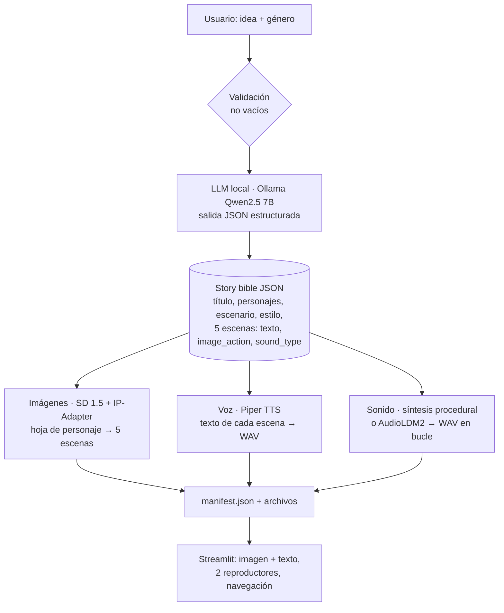

# Arquitectura y flujo de datos

## Transferencia de información entre componentes

El único canal es el **story bible** (objeto `Story`, `storybook/schemas.py`), serializado en `story.json`:

| Componente | Recibe | Produce |
|---|---|---|
| LLM | idea, género, reglas de consistencia | `title`, `setting`, `art_style`, `characters[].visual_description`, `scenes[]` |
| Imágenes | `art_style` + `visual_description` + `scenes[i].image_action` + `setting` | `character_ref.png`, `scene_i.png` |
| Voz | `scenes[i].text` | `scene_i_voice.wav` (+ duración) |
| Sonido | `scenes[i].sound_type`, `sound_prompt`, duración de la voz | `scene_i_ambient.wav` |
| Interfaz | `manifest.json` | visualización y reproducción |

## Gestión de memoria (6 GB de VRAM)

Los modelos se cargan **de forma secuencial** y se liberan al terminar: el LLM usa `keep_alive=0` (Ollama descarga el modelo),
`ImageGenerator.unload()` vacía la caché CUDA, y Piper y el sonido procedural corren en CPU. Si Stable Diffusion se queda sin VRAM,
se activa automáticamente `enable_model_cpu_offload()` y se reintenta.

## Manejo de fallos

| Fallo | Respuesta |
|---|---|
| JSON inválido / ≠ 5 escenas / protagonista ausente | Reintento (hasta 3) enviando el error al LLM |
| Ollama cerrado o modelo no descargado | Mensaje explícito con el comando a ejecutar |
| CUDA out of memory | Offload a CPU y reintento |
| Fallo de imagen | Reintento con otra semilla |
| AudioLDM2 no disponible | Respaldo automático a síntesis procedural |
| Entradas vacías | Validación antes de cualquier generación |
